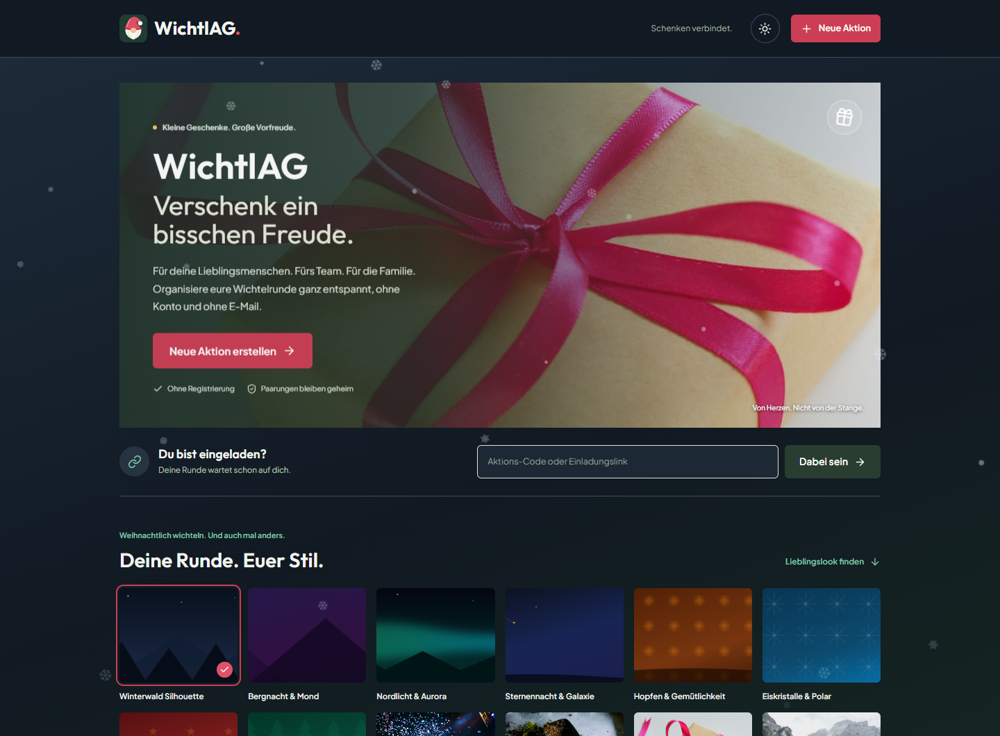
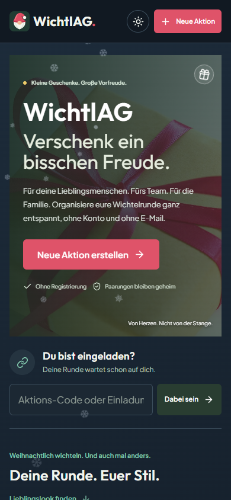
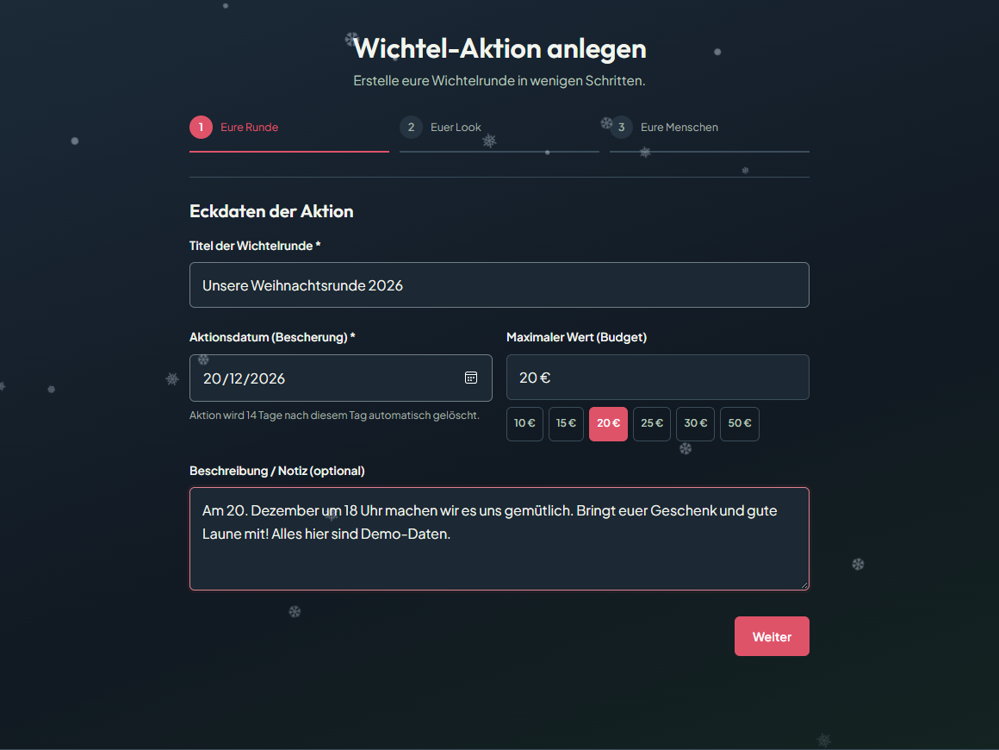
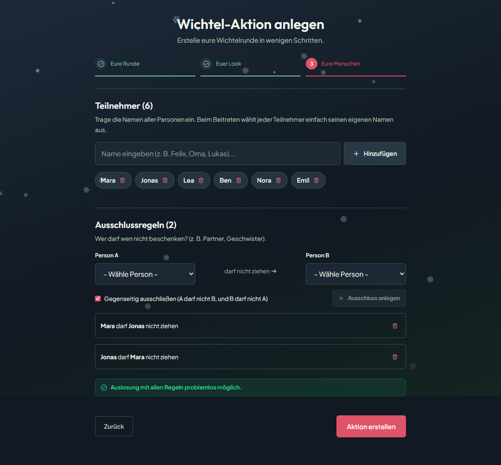
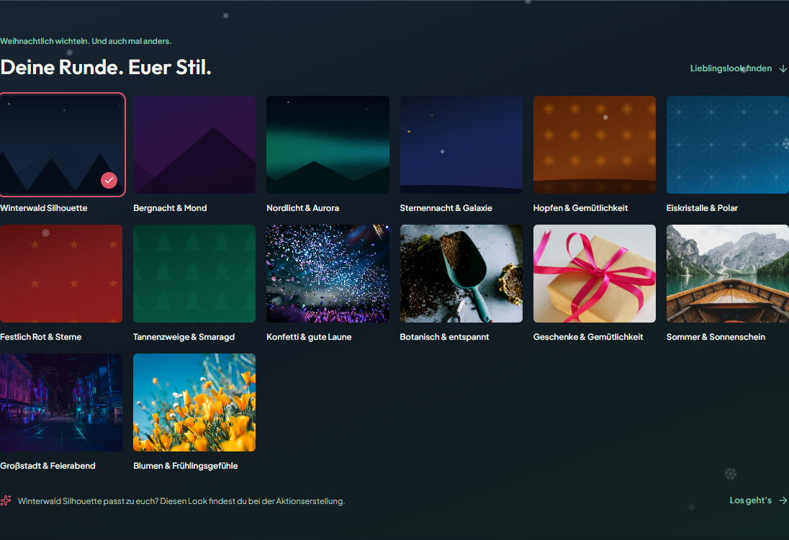
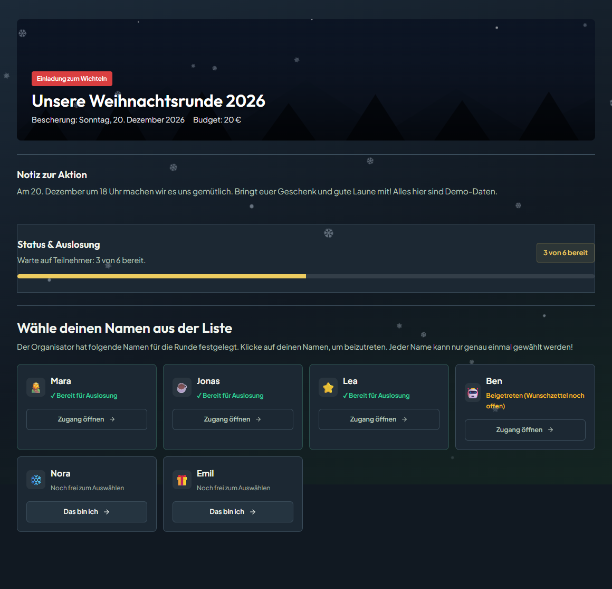
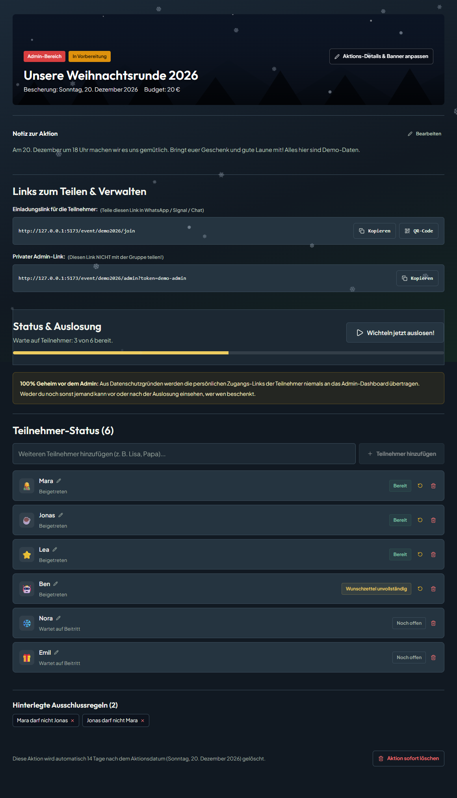
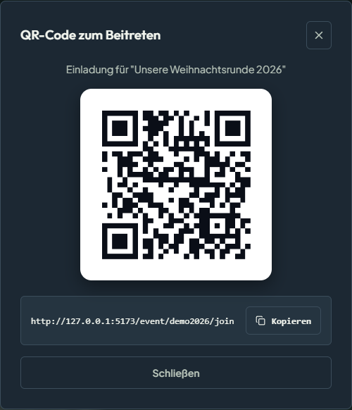
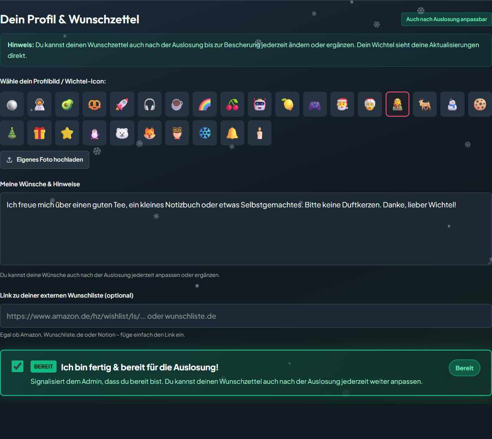
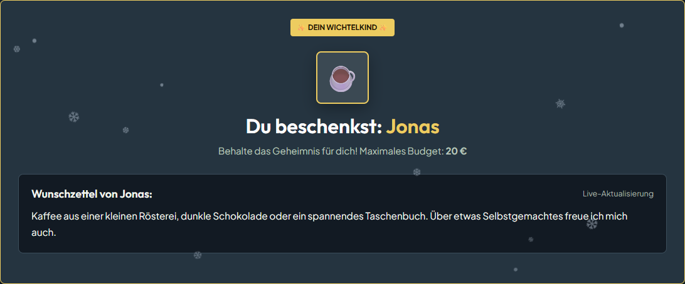

# WichtlAG

<p align="center">
  
</p>

Kleine Geschenke. Große Vorfreude. WichtlAG ist eine selbstgehostete Wichtel-Web-App für Freunde, Familie und Teams: ohne Registrierung, ohne Passwörter und ohne E-Mail-Server. Einladungen und persönliche Zugänge funktionieren über Links. Die Organisation sieht den Stand der Runde, aber keine Auslosungs-Paarungen.

## Sneak Peek

Winterlicher Look mit fallenden Schneeflocken, dunklem und hellem Design sowie einer Oberfläche für Handy und PC. Die Screenshots zeigen die echte Oberfläche mit fiktiven Demo-Daten. Namen, Wunschzettel und Zugangslinks gehören zu keiner echten Wichtelrunde.

### Auf dem PC



<details>
<summary>Auf dem Handy ansehen</summary>

<p align="center">
  
</p>

</details>

### Einblicke in die Funktionen

<details>
<summary>Aktion erstellen: Datum, Budget und gemeinsame Notiz</summary>

Titel, Bescherungstermin und Budget festlegen. Eine Notiz hält Treffpunkt und weitere Absprachen für alle fest.



</details>

<details>
<summary>Teilnehmer und Ausschlüsse festlegen</summary>

Namen zur Runde hinzufügen und festlegen, wer wen nicht beschenken darf. Die bestehende Prüfung zeigt direkt, ob eine vollständige Auslosung möglich ist.



</details>

<details>
<summary>14 Banner-Themes: Weihnachten zuerst, weitere Anlässe inklusive</summary>

Winterwald, Nordlicht, Eiskristalle, Rot-Gold und Tannengrün gehören ebenso dazu wie Konfetti, Blumen oder Sommermotive. Eigene Banner können hochgeladen werden.



</details>

<details>
<summary>Einladung öffnen und den eigenen Namen auswählen</summary>

Die gemeinsame Einladung zeigt Datum, Budget und den aktuellen Stand. Jeder wählt seinen eigenen, noch freien Namen und erhält einen persönlichen Zugang.



</details>

<details>
<summary>Admin-Dashboard: organisieren, teilen und auslosen</summary>

Die Organisation verwaltet Details, Teilnehmer und Ausschlüsse, teilt den Einladungslink und startet die Auslosung. Persönliche Teilnehmer-Links und Paarungen werden nicht im Admin-Dashboard angezeigt.



</details>

<details>
<summary>Per QR-Code einladen</summary>

Die gemeinsame Einladung lässt sich auch als QR-Code anzeigen und direkt mit dem Smartphone öffnen.

<p align="center">
  
</p>

</details>

<details>
<summary>Wunschzettel, 28 Avatare und Bereitschaftsstatus</summary>

Avatar aussuchen oder ein eigenes Foto hochladen, Wünsche notieren und sich bereit melden. Wunschzettel können auch nach der Auslosung bis zur Bescherung aktualisiert werden.



</details>

<details>
<summary>Das eigene Wichtelkind enthüllen</summary>

Nach der Auslosung öffnet jeder über seinen persönlichen Zugang das Geschenk und sieht sein Wichtelkind samt Wunschzettel.



</details>

## Highlights

- **Ohne Konto und E-Mail:** Einladungslink im Gruppenchat teilen oder QR-Code scannen.
- **Geheime Paarungen:** Das Admin-Dashboard zeigt Teilnahme und Bereitschaft, nicht die Ergebnisse der Ziehung.
- **Flexible Organisation:** Aktionsdetails und Banner nachträglich ändern; vor der Auslosung Teilnehmer hinzufügen, umbenennen oder entfernen.
- **Ausschlussregeln:** Beispielsweise verhindern, dass Partner einander ziehen; optional gegenseitig.
- **Persönliche Wunschzettel:** Geschenkideen, Hinweise und ein Link zu einer externen Wunschliste.
- **14 Themes und 28 Avatare:** Festliche Motive, weitere Anlässe und eigene Bilduploads.
- **Winterdesign für Handy und PC:** Fallende Schneeflocken, gespeicherte Hell-/Dunkel-Auswahl, Touch-Bedienung und Berücksichtigung reduzierter Bewegung.
- **Kleine Überraschungen:** Im Geschenk-Symbol auf der Startseite verstecken sich Konfetti und wechselnde Sprüche.
- **Automatisches Aufräumen:** Aktionsdaten und Uploads werden nach Ablauf der Aufbewahrungsfrist von 14 Tagen nach der Bescherung gelöscht.

## So funktioniert die Runde

1. Aktion mit Datum, Budget, Banner und Teilnehmern erstellen.
2. Den gemeinsamen Einladungslink oder QR-Code teilen.
3. Jeder wählt seinen Namen, füllt den Wunschzettel aus und meldet sich bereit.
4. Die Organisation startet die Auslosung; jeder enthüllt sein Wichtelkind über den persönlichen Zugang.

**Persönliche Links aufbewahren:** Der Link ist der Zugang. Admin- und Teilnehmer-Links nicht öffentlich teilen. Es gibt keine Wiederherstellung per E-Mail und kein Passwort-Login.

## Lokal mit Docker starten

Voraussetzung: Docker mit laufender Container-Engine. Diese Befehle bauen den aktuellen Projektstand und veröffentlichen die Anwendung lokal auf Port 3000:

```bash
docker build -t wichtlag:local .
docker run -d --name wichtlag -p 3000:3000 --mount source=wichtlag-data,target=/app/data wichtlag:local
```

Anschließend unter **http://localhost:3000** öffnen. Das benannte Volume `wichtlag-data` speichert Datenbank und Uploads persistent.

### Vorhandene Docker-Compose-Konfiguration

Die mitgelieferte `docker-compose.yml` ist für den Betrieb hinter **Traefik** vorgesehen, nicht für einen direkten lokalen Portzugriff. Sie verwendet das veröffentlichte Image `ghcr.io/fscorrupt/wichtlag:latest` und baut den lokalen Quellstand nicht automatisch.

Vor dem Start `APPFOLDER` und `DOMAIN` konfigurieren, das externe Netzwerk `proxy` bereitstellen und die Traefik-Labels an die eigene Installation anpassen. `APPFOLDER` bestimmt das persistente Host-Verzeichnis. Anschließend:

```bash
docker compose up -d
```

Die Beispielroute lautet `https://wichtel.${DOMAIN}`. Für den aktuellen lokalen Quellstand die oben beschriebenen Build-Befehle verwenden oder das selbst gebaute Image in der eigenen Compose-Konfiguration eintragen.

## Manuelle Installation

Empfohlen: **Node.js 22 LTS ab 22.12** oder **Node.js 24 LTS** und npm. Das aktuelle Vite benötigt mindestens Node.js 20.19 beziehungsweise 22.12; Node.js 18 wird nicht unterstützt.

```bash
npm ci
npm run build
npm start
```

Die Anwendung ist standardmäßig unter **http://localhost:3001** erreichbar. Express liefert das gebaute Frontend und die API aus.

`better-sqlite3` benötigt ein passendes natives Modul. Falls kein vorgebautes Binary verfügbar ist, sind Python und die C++-Build-Werkzeuge der Plattform erforderlich, unter Windows die Visual Studio Build Tools mit dem Workload **Desktopentwicklung mit C++**. Der Docker-Build bringt die erforderlichen Build-Werkzeuge mit.

## Konfiguration

| Variable | Standard | Bedeutung |
|---|---|---|
| `PORT` | `3001` lokal, `3000` im Docker-Image | Port des Express-Servers |
| `DATA_DIR` | `./data` lokal, `/app/data` im Docker-Image | Verzeichnis für SQLite-Datenbank und Uploads |

Neue Installationen verwenden `wichtlag.sqlite`. Eine vorhandene `wichtelmat.sqlite` wird weiterhin verwendet, solange noch keine `wichtlag.sqlite` existiert. Uploads liegen im Unterverzeichnis `uploads`.

## Datenschutz und Betrieb

- Die API überträgt keine Auslosungs-Paarungen an den Adminbereich und keine persönlichen Teilnehmer-Links an die Organisation.
- Zugangslinks enthalten geheime Token. Für öffentlichen Betrieb HTTPS verwenden und diese Links wie Passwörter behandeln.
- Die Daten liegen auf dem eigenen Server. Personen mit direktem Zugriff auf Server oder Datenbank können auf diese Daten zugreifen; die Geheimhaltung im Admin-Dashboard ersetzt keine Verschlüsselung gegenüber dem Betreiber.
- Das Docker-Image läuft unter dem unprivilegierten Benutzer `node`. Die vorhandene Compose-Konfiguration setzt zusätzlich `no-new-privileges`.
- Datenbankabfragen verwenden Prepared Statements; SQLite läuft mit WAL-Modus.
- Für Backups die Datenbank inklusive ihres aktuellen WAL-Zustands konsistent sichern, beispielsweise über ein SQLite-Backup-Verfahren. Das Upload-Verzeichnis ebenfalls berücksichtigen.

## Entwicklung

```bash
npm run dev
```

Startet die API auf Port 3001 und Vite auf Port 5173. Vite leitet `/api` und `/uploads` an das Backend weiter.

```bash
npm run build
```

Erstellt das Produktions-Frontend unter `dist`.

### Screenshots aktualisieren

Die statischen PNG-Dateien unter `docs/screenshots` ersetzen den bisherigen GIF-Sneakpeek. Sie lassen sich mit der echten Oberfläche und isolierten Demo-Antworten neu erzeugen; ein laufendes Backend ist dafür nicht nötig.

```bash
# Terminal 1: Frontend starten
npm run client

# Terminal 2: zehn Screenshots erzeugen
npm run screenshots
```

Playwright verwendet unter Windows standardmäßig den installierten Microsoft Edge. Auf anderen Plattformen zunächst Chromium mit `npx playwright install chromium` installieren. Die optionale Umgebungsvariable `PLAYWRIGHT_CHANNEL` wählt einen anderen installierten Browserkanal; `SCREENSHOT_BASE_URL` überschreibt die Standardadresse `http://127.0.0.1:5173`.

Der Ablauf fängt API-Anfragen im Browser ab, blockiert Schreibanfragen und prüft Browserfehler sowie horizontalen Überlauf. Die Screenshots sind eine Funktionsvorschau, kein Nachweis eines vollständigen Backend-Tests.

### Logo und Browser-Icons

Das Wichtel-Motiv mit roter Zipfelmütze ist als skalierbare Quelle in `public/logo.svg` hinterlegt. Navigation und moderne Browser verwenden direkt diese SVG-Datei. Zusätzlich gibt es das PNG-Logo, ein 32-Pixel-Favicon und ein 180-Pixel-Apple-Touch-Icon für Smartphone-Lesezeichen.

Nach einer Änderung am SVG lassen sich die PNG-Varianten ohne laufenden Webserver neu erzeugen:

```bash
npm run icons
```

Der Export verwendet dieselbe Playwright-Browserauswahl wie die Screenshots. Anschließend `npm run screenshots` ausführen, damit die Vorschau das aktuelle Logo zeigt.

### Themenfotos

Die Fotos liegen lokal unter `public/themes`. Beim Seitenaufruf ist daher keine Verbindung zu Unsplash nötig. Originalquellen: [Geschenk](https://images.unsplash.com/photo-1513201099705-a9746e1e201f), [Party](https://images.unsplash.com/photo-1492684223066-81342ee5ff30), [Pflanzen](https://images.unsplash.com/photo-1416879595882-3373a0480b5b), [Sommer](https://images.unsplash.com/photo-1476514525535-07fb3b4ae5f1), [Großstadt](https://images.unsplash.com/photo-1519608487953-e999c86e7455) und [Blumen](https://images.unsplash.com/photo-1490750967868-88aa4486c946).

## Lizenz

MIT